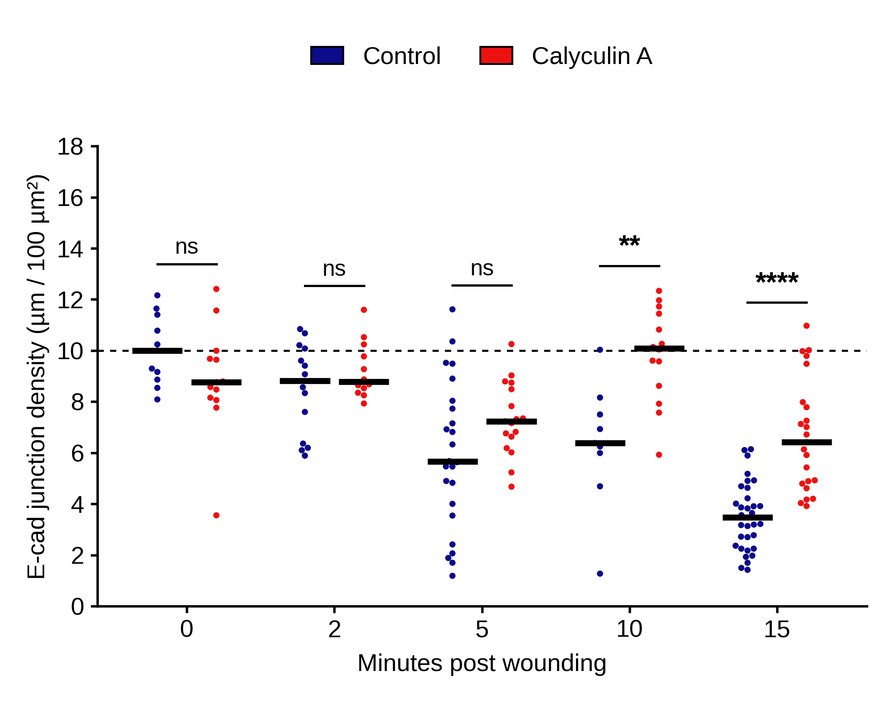

# ecad-junction-quant

Quantify E-cadherin junctions in wound-proximal confocal images (Olympus FV3000 `.oir`), per field and per cell territory, across a wounding time course (0, 2, 5, 10, 15 min) with and without Calyculin A (CalA).

The pipeline reads `.oir` files directly (no Bio-Formats / Java), traces junctions from the E-cadherin signal itself, and reports threshold-robust metrics with field-aware statistics.



## What is in this repository

| Path | Contents |
|---|---|
| `ecad_junctions/oirread.py` | Minimal parser for the Olympus OIR container (800x800, 12-bit stacks, channel identification by UUID) |
| `ecad_junctions/convert.py` | `.oir` to cached `.npz` (uint16 stacks + PMT voltage / laser / zoom metadata) |
| `ecad_junctions/ecad_quant.py` | Main pipeline: tissue and wound-gap masks, nuclei, junction tracing, field and per-cell metrics, QC overlays |
| `ecad_junctions/timecourse_stats.py` | Field-level statistics (time vs own 0 min, CalA vs control, interaction, trend, voltage sensitivity) |
| `ecad_junctions/cell_stats.py` | Cell-level statistics with field-aware permutation tests and cluster bootstrap |
| `ecad_junctions/plot_fig2E_style.py`, `plot_cells_fig2E.py` | Prism-style swarm plots (field level, cell level) |
| `ecad_junctions/build_timeline_xlsx.py` | Excel workbooks in the lab's "one sheet per time point" layout (cells across columns, Mean column, `Regression` summary sheet) |
| `fiji/Ecad_junction_quant.ijm` | Simplified Fiji macro. **Untested, and uses the older single-threshold detector.** Sanity checks only |
| `data/results/` | Per-field metrics (170 fields), per-cell metrics (4,715 cell territories), and all statistics tables from the reported analysis |
| `figures/` | Final plots and example QC overlays |
| `docs/METHODS.md` | Detailed methods, metric definitions and statistics |

Raw `.oir` files are **not** included (several GB). Everything in `data/results` can be regenerated from them.

## Quick start

```bash
pip install -r requirements.txt

# 1. convert raw files (file names must start with "[CalA ]<time> Min ..." , e.g. "CalA 5 Min WP E-Cad_0003.oir")
python ecad_junctions/convert.py --src /path/to/oir_folder --dst cache

# 2. quantify (fields + cells); writes results/per_image_metrics.csv, per_cell_metrics.csv and results/qc/*.png
python ecad_junctions/ecad_quant.py --cache cache --out results --cells --procs 2

# 3. statistics and plots
python ecad_junctions/timecourse_stats.py results
python ecad_junctions/cell_stats.py results
python ecad_junctions/plot_fig2E_style.py results
RES=results OUTD=figures python ecad_junctions/plot_cells_fig2E.py

# 4. Excel files in the timeline layout (optional)
RES=results OUTD=timeline_xlsx python ecad_junctions/build_timeline_xlsx.py
```

To use your own pixel size, edit `PIXEL_UM` in `ecad_quant.py` or pass `--pixel-um`. Treatment and time are parsed from the file name by `group_of()`.

Detection mode: `ECAD_MODE=hyst` (default, used for all reported results), `global` (legacy single global threshold) or `localnorm` (experimental; adds speckle).

## Main readouts

| Metric | Meaning |
|---|---|
| `skel_density` | Traced junction length per tissue area (um per 100 um2) |
| `continuous_frac` | Fraction of traced junction length in segments of at least ~13 um |
| `ridge_snr_p95` | Threshold-free ridge-filter signal-to-noise (95th percentile) |
| `segments_per_100um`, `mean_segment_um` | Fragmentation |
| `JC_ratio`, `ridge_contrast` | Junction vs cytoplasm / local-background E-cad |
| per cell: `junction_density`, `has_junction`, `continuity`, `ridge_snr`, `JC_ratio` | Same ideas within nucleus-seeded territories |

Intensity-based readouts (`junction_bgsub`, `total_ecad_bgsub`) depend on detector voltage and are provided as secondary columns only.

## Summary of the included dataset (170 fields)

Fold change in field-level junction density relative to the same treatment's 0 min (median): control 0.88 / 0.57 / 0.64 / 0.35 at 2 / 5 / 10 / 15 min; CalA 1.00 / 0.83 / 1.15 / 0.73. Averaged over 5, 10 and 15 min CalA retains 0.90 of baseline vs 0.52 for control. Full tables: `data/results/stats_*.csv`.

## Limitations (please read before reusing the numbers)

1. **One biological replicate.** All p-values describe field-to-field variation within a single experiment. They do not establish reproducibility.
2. **Detector voltage was adjusted per field** to avoid saturation and rises with time in control (E-cad PMT 505-614 V). Raw intensities are not comparable; higher voltage is associated with lower detected junction density. The 15 min control cannot be voltage-matched. See `stats_PMT_sensitivity.csv`.
3. **Imaging day is confounded with group** (same sample imaged on different days; settings otherwise identical).
4. **Pixel size is assumed** (0.265 um/px; not stored in these `.oir` files). um and um2 values scale with it; ratios, fractions and p-values do not.
5. **"Cells" are nucleus-seeded territories, not segmented cells.** Cells within a field are not independent; use the field-aware p-values (`p_field_aware_*`), not the naive per-cell ones. Many territories contain no junction, so continuity and J/C ratio exist only for cells that have one.
6. **Junctions are defined from the E-cadherin signal** (detectable junction signal, not ground truth). Some early-acquired fields in the control 5 min set show nuclear-shaped E-cad signal and almost no traceable junctions; see `docs/METHODS.md`.
7. Channels are identified from file metadata (DAPI 405, actin 488, DNMT3a 561, E-cad 647) for the FV3000 files used here; other microscopes or channel layouts need changes in `convert.py`.

## Citation and licence

MIT licence (see `LICENSE`). If you use this, please cite the repository URL and the release/commit you used.
